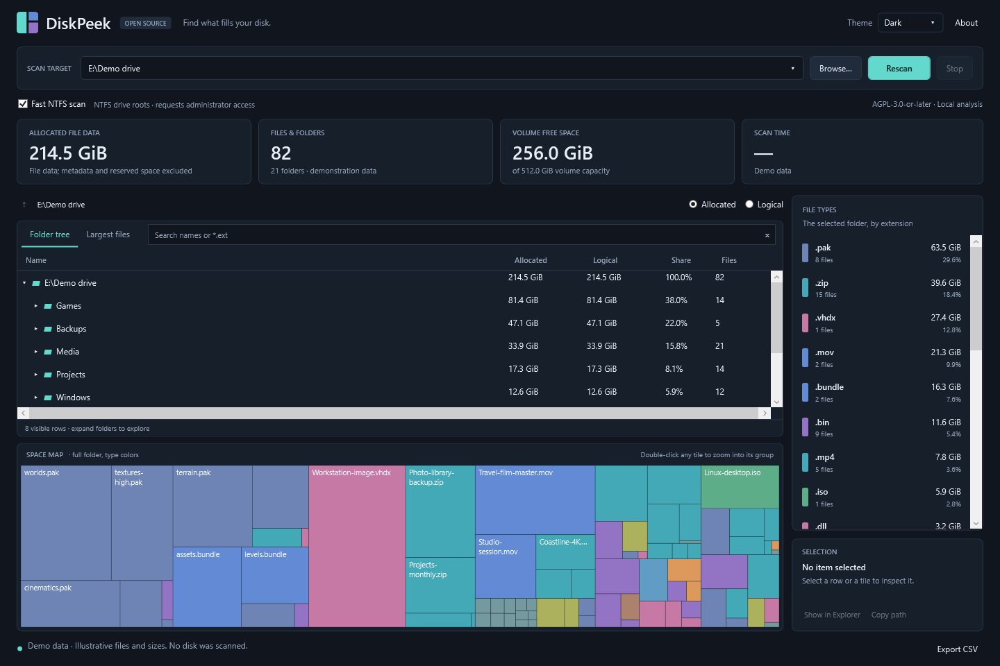
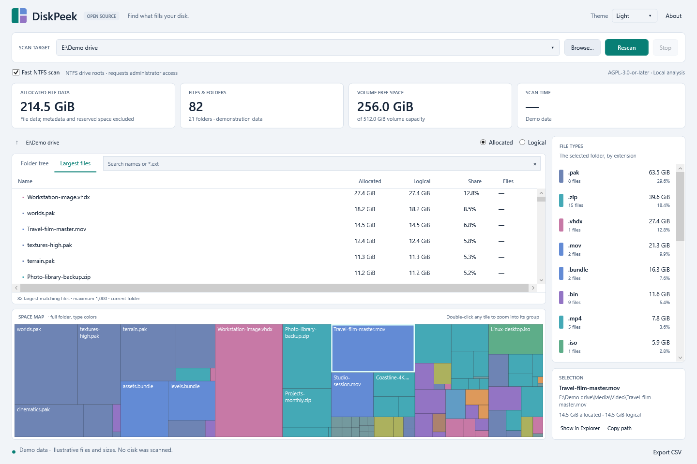

# DiskPeek

A Windows disk-usage analyzer with a folder tree, largest-files view, file-type
statistics, interactive treemap, search, and CSV export. Independent of WizTree
and WinDirStat. Copyright (C) 2026 DiskPeek contributors.

**[Install DiskPeek for Windows x64](https://github.com/GoByeBye/DiskPeek/releases/latest/download/DiskPeek-setup-win-x64.exe)** · [Portable ZIP](https://github.com/GoByeBye/DiskPeek/releases/latest/download/DiskPeek-portable-win-x64.zip) · [Latest release](https://github.com/GoByeBye/DiskPeek/releases/latest)

**License: GNU AGPL version 3 or later.** See [LICENSE](LICENSE).

[](https://github.com/GoByeBye/DiskPeek/actions/workflows/build.yml)

Source: [GoByeBye/DiskPeek](https://github.com/GoByeBye/DiskPeek).

## Screenshots

The actual DiskPeek interface with demonstration data.

**Folder tree and treemap · dark theme**



**Largest files · light theme**



## Run

Run the installer to install DiskPeek for your Windows account, add its Start
menu shortcut, and enable in-app updates. Installation does not require
administrator access. Uninstall through Windows **Settings → Apps**.

Installed copies check for stable GitHub releases in the background, at most once
per day, and notify you when a newer version is available. Use **Updates** to check
manually, turn background checks off, download an update, or choose **Update and
restart**. Updates require your approval; they are not silently downloaded or
applied. Export any scan you want to keep before restarting. Theme and update
preferences are stored separately from the installed application files.

The portable ZIP is also available:

Extract the complete downloaded portable ZIP and launch `DiskPeek.exe`.
Keep `DiskPeek.Worker.exe` and the other packaged files beside it. Windows x64 is
required; no .NET installation is needed for the self-contained release.
Portable copies link to the installer instead of replacing their own files.
See [installation and updates](docs/INSTALLATION.md) for details.

Choose a drive, browse to a folder, or enter a network path, then select **Scan**.
**Fast NTFS scan** is enabled by default. Supported local NTFS drive roots use a
separate read-only volume worker after a Windows administrator prompt. Folders,
non-NTFS drives, and network paths automatically use directory scanning without
requesting elevation. If the worker is unavailable or elevation is declined,
the app falls back to directory scanning and records the reason. Clear the
checkbox to use directory scanning for every target. The app starts idle;
selecting **Scan** starts the scan and any required administrator prompt.

- Click a folder chevron to expand. Double-click any treemap tile to zoom into
  its folder group, including a file tile inside that group. Enter does the same
  when the treemap has focus. Double-clicking a folder in the tree also zooms.
- Hover over a file tile to highlight the visible files in the same immediate
  folder and accent its corresponding folder row in the tree. The tree reveals
  the folder after a short hover, keeping the selected file and filters intact.
- Use breadcrumbs or Alt+Up to zoom out. Select a file type to filter, and select
  it again to clear the filter.
- Search names with case-insensitive text, `*`, or `?`. Ctrl+F focuses search.
- Switch between allocated and logical bytes; both are visible in the file table.
- F5 scans/rescans; Escape stops scanning while retaining partial results.
- Right-click or use the selection panel to copy paths or reveal files in Explorer.
- Export CSV writes the complete scan, including accounting and error status.

Scanning reads metadata without modifying scanned files. Cloud placeholder
contents are not downloaded. Directory reparse points, including junctions and
mounted volumes, are shown without traversing their targets.

## Deleted items and Recycle Bin

DiskPeek watches for deletions and moves while the scan runs and afterwards.
Confirmed missing paths turn red in the treemap and file table. A grouped folder
containing affected items gets a red indicator. Original tile areas, sizes,
file-type statistics, and CSV exports remain a snapshot of the scan; they are
not an estimate of space reclaimed. Rescan refreshes everything and clears the
highlights, including paths that were recreated or restored.

To remove an item, select an actual file or folder, then choose **Move to Recycle
Bin** from the selection panel or table context menu, or press **Delete** while
the table or treemap has focus. The confirmation shows the full path; a folder
operation covers all its current contents, including changes since the scan.
The selected item and its parent identities are checked again before recycling.

Recycling runs with the app's ordinary permissions. There is no permanent-delete
fallback or elevated deletion worker. Scan roots, network/removable locations,
links, cloud placeholders, and entries without a verifiable identity must be
managed in Explorer. Contents in the Recycle Bin continue to use disk space.

Change notifications are best effort. Buffer overflow, unavailable storage, and
unreadable metadata are reported as incomplete tracking; access failures are
never interpreted as proof of deletion. See [deletion behavior](docs/DELETIONS.md).

## What the sizes mean

**Allocated file data** is the measured storage of the unnamed/main data stream.
It accounts for resident NTFS data, sparse holes, and NTFS compression. Hard-link
paths share storage: allocated bytes count once within the selected scan scope,
attributed to the first path in ordinal case-insensitive order. Other links are
marked shared. Logical bytes represent each path's main-stream length.

Alternate data streams, filesystem metadata, reserved space, and shared storage
features such as deduplication are not represented as exact reclaimable bytes.
Reparse-backed file allocation (including unsupported WOF/cloud representations)
is unmeasured in this version. These values show `—`; incomplete folder totals
show the known sum and an incomplete indicator. The allocated map only includes
measured bytes. Volume free/capacity figures are separate from file totals.
If stable IDs are unavailable, the scan warns that hard-link allocation may be
duplicated. A scan observes a live filesystem rather than an atomic snapshot.

## Build and verify

Run from PowerShell on Windows x64:

```powershell
.\scripts\build.ps1
```

The script downloads the pinned official .NET SDK **10.0.403** to `work/sdk`,
verifies its SHA-512 checksum, builds Release, runs the console verification
suite, and publishes an installer, self-contained portable app, update feed,
and corresponding source under `outputs`. Build/tool caches remain in `work`;
Visual Studio is optional.
The first build requires access to Microsoft's download host and NuGet.org for
Microsoft runtime packs and Velopack. The updater library and workspace-local
packaging tool are both pinned to Velopack 1.2.161.

Use `-SkipPackage` for a development build/test cycle or `-SkipTests` to skip
verification explicitly. Fixtures are created and retained only beneath `work`;
some fixture creation and raw-volume validation require additional Windows
permissions. Verification reports distinguish skipped scenarios from passes.

With an existing pinned SDK, use `-DotnetExe (Get-Command dotnet).Source`.
`-OutputDirectory outputs/ci` isolates build deliverables; package names follow
the version in `Directory.Build.props`. Builds use `work/build/bin` so running
portable copies do not lock the compiler's output.

## CI and releases

GitHub Actions builds, runs the verification suite, and packages Windows x64
artifacts for pushes to `main`, pull requests, and manual runs. Successful runs
provide the installer, portable ZIP (with corresponding source), a separate
source ZIP, update package and feed, and SHA-256 checksums. Verification
diagnostics are uploaded even on failure. Every release also includes stable
installer and portable asset names, so both download links above follow the
latest stable release automatically.

To publish a release, update the version in `Directory.Build.props`, commit it,
then push a matching tag such as `v0.1.0`. The tag pipeline repeats verification
before publishing those assets to GitHub Releases. A normal branch push does
not publish a release. See [CI details](docs/CI.md).

```powershell
$env:DOTNET_ROOT = (Resolve-Path .\work\sdk).Path
.\src\DiskPeek.App\bin\Release\net10.0-windows\DiskPeek.exe --target .\src --scan
```

For a framework-dependent development app, also place the built worker files
beside `DiskPeek.exe` to exercise optional elevation; the release script does
this automatically in the portable package.

## CLI and repeatable measurements

The portable package includes `DiskPeek.Cli.exe`:

```powershell
.\DiskPeek.Cli.exe scan C:\Data --engine directory --metric allocated --csv scan.csv
.\DiskPeek.Cli.exe scan C:\ --engine mft
.\DiskPeek.Cli.exe benchmark C:\Data --runs 5 --output benchmark.json
.\DiskPeek.Cli.exe synthetic --count 1000000 --output synthetic.json
```

`--engine mft` attempts direct metadata access using the current CLI process's
permissions; it does not silently request elevation. Unsupported/denied direct
access falls back to directory scanning and records the reason.

`benchmark` warms both engines, alternates order, and uses a fresh child process
per sample. It compares the batched scanner against a straightforward managed
walker that opens per-entry metadata handles using the same accounting. Reports
include matched totals, wall/CPU time, first progress, allocations, memory, and
cancellation latency. These measurements do not establish speed relative to
WizTree or WinDirStat. OS caches are not flushed; cold-cache measurements require
separate operator-controlled runs and must be labeled accordingly.

Create the standard 16,384-file/64-directory/64-MiB fixture with:

```powershell
.\scripts\create-benchmark-fixture.ps1
```

The WPF app also supports `--ui-benchmark <report.json> --synthetic-count 1000000`
for repeatable real-control virtualization and responsiveness checks. It seeds
only an in-memory model and leaves the window open for inspection.

## Design

- `DiskPeek.Core`: compact result arrays, adjacency/totals, directory/MFT engines,
  CSV, and authenticated worker transport.
- `DiskPeek.App`: WPF UI, lazy row adapters, background search/projections, and a
  custom treemap drawing surface.
- `DiskPeek.Worker`: narrowly scoped elevated local-NTFS scanner; read-only volume
  handles, current-user named pipe, one-use token, and peer PID validation.
- `DiskPeek.Cli`: analysis, baseline comparisons, and synthetic model measurements.
- `DiskPeek.Tests`: standalone verification runner without a test-framework dependency.

NTFS records, extents, and references are bounds checked. Unsupported metadata
formats or raw I/O failures produce a documented fallback or partial result.
Raw metadata parsing is isolated from the graphical process during elevated
operation. See `docs/VALIDATION.md` and the shipped reports for the actual
verification coverage and remaining limitations of this release.
